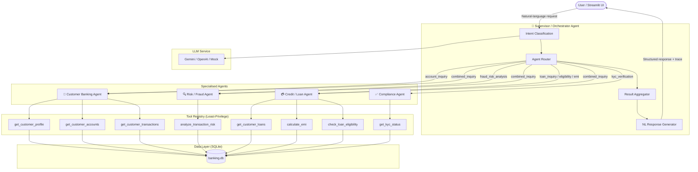

# Multi-Agent Banking Assistant

> **Wrench Wise EduTech AI/ML Internship Assignment**  
> A simulated real-time banking AI system powered by a Supervisor/Orchestrator Agent and four specialised sub-agents.

---

## ⚠️ Disclaimer

**All banking data, customers, accounts, transactions, and loans in this application are entirely fictional and are used for demonstration purposes only. No real banking operations, real financial decisions, or live financial services are involved.**

---

## 1. Project Overview

The Multi-Agent Banking Assistant is an MVP (Minimum Viable Product) that demonstrates a multi-agent AI architecture applied to retail banking. A central **Supervisor/Orchestrator Agent** receives natural-language requests, classifies intent, and delegates tasks to specialised agents:

| Agent | Responsibility |
|---|---|
| **Customer Banking Agent** | Profiles, accounts, balances, transactions |
| **Risk / Fraud Agent** | Rule-based transaction risk scoring |
| **Credit / Loan Agent** | Loan retrieval, eligibility checks, EMI calculation |
| **Compliance Agent** | Simulated KYC verification |

---

## 2. Architecture Diagram



---

## 3. Technology Stack

| Component | Technology |
|---|---|
| Frontend | Streamlit 1.40+ |
| Backend | FastAPI 0.115+ |
| Data validation | Pydantic v2 |
| Database | SQLite (via SQLAlchemy 2.0) |
| LLM — real mode | Google Gemini (`gemini-1.5-flash`) |
| LLM — alternative | OpenAI (`gpt-4o-mini`) |
| LLM — fallback | Deterministic keyword/regex (mock mode) |
| Data processing | Pandas, NumPy |
| HTTP client | HTTPX / Requests |
| Testing | Pytest |
| Language | Python 3.11+ (tested on 3.14) |

---

## 4. Project Structure

```
banking-multi-agent-mvp/
├── app.py                       # Streamlit entry point
├── backend/
│   ├── main.py                  # FastAPI application
│   ├── config.py                # Settings (env vars)
│   ├── database.py              # SQLAlchemy engine + sessions
│   ├── models.py                # ORM models
│   ├── schemas.py               # Pydantic request/response schemas
│   ├── api/
│   │   ├── customers.py         # Customer/account endpoints
│   │   ├── loans.py             # Loan/EMI/eligibility endpoints
│   │   ├── compliance.py        # KYC endpoints
│   │   └── risk.py              # Risk/fraud endpoints
│   ├── agents/
│   │   ├── orchestrator.py      # Supervisor Orchestrator
│   │   ├── customer_agent.py    # Customer Banking Agent
│   │   ├── risk_agent.py        # Risk / Fraud Agent
│   │   ├── credit_agent.py      # Credit / Loan Agent
│   │   └── compliance_agent.py  # Compliance Agent
│   ├── tools/
│   │   ├── registry.py          # Central tool registry
│   │   ├── banking_tools.py     # Customer/account/transaction tools
│   │   ├── risk_tools.py        # Fraud detection rules
│   │   └── loan_tools.py        # Loan/EMI/KYC tools
│   └── services/
│       ├── llm_service.py       # LLM integration + mock fallback
│       └── response_service.py  # Response formatting utilities
├── frontend/
│   └── streamlit_app.py         # Streamlit dashboard UI
├── scripts/
│   └── seed_database.py         # DB init + seeding script
├── tests/
│   ├── conftest.py              # Shared fixtures
│   ├── test_customers.py
│   ├── test_risk.py
│   ├── test_loans.py
│   ├── test_compliance.py
│   ├── test_orchestrator.py
│   └── test_api.py
├── data/                        # SQLite database (git-ignored)
│   └── .gitkeep
├── .env.example                 # Environment variable template
├── .gitignore
├── requirements.txt
└── README.md
```

---

## 5. Prerequisites

- **Python 3.11+** (tested on 3.14.0)
- **pip** (included with Python)
- **Git** (optional, for version control)
- **(Optional) Google Gemini API key** — from [https://aistudio.google.com/app/apikey](https://aistudio.google.com/app/apikey)

---

## 6. Installation — Windows

### Step 1 — Clone or download the project

```powershell
cd E:\Github
git clone <repo-url> banking-multi-agent-mvp
cd banking-multi-agent-mvp
```

Or if you already have the folder:

```powershell
cd E:\Github\banking-multi-agent-mvp
```

### Step 2 — Create and activate a virtual environment (recommended)

```powershell
python -m venv venv
.\venv\Scripts\Activate.ps1
```

If PowerShell blocks scripts:

```powershell
Set-ExecutionPolicy -ExecutionPolicy RemoteSigned -Scope CurrentUser
.\venv\Scripts\Activate.ps1
```

### Step 3 — Install dependencies

```powershell
pip install -r requirements.txt
```

### Step 4 — Set up environment variables

```powershell
copy .env.example .env
```

Open `.env` in Notepad and configure:

```env
# For real LLM responses (optional):
LLM_PROVIDER=gemini
GEMINI_API_KEY=your_actual_key_here

# For mock mode (no API key needed):
LLM_PROVIDER=mock
```

### Step 5 — Initialise and seed the database

```powershell
python scripts/seed_database.py
```

Expected output:
```
✅ Database seeded successfully!
  CUST001 — Arjun Sharma    (Good credit, home loan)
  CUST002 — Priya Verma     (Suspicious transactions, medium KYC risk)
  CUST003 — Rahul Gupta     (Below-average credit, auto loan, KYC pending)
  CUST004 — Sneha Patel     (Good credit, education loan, FD)
  CUST005 — Vikram Singh    (KYC failed, account frozen, multiple missing fields)
```

---

## 7. Running the Application

### Start the FastAPI Backend

Open **Terminal 1**:

```powershell
uvicorn backend.main:app --host 127.0.0.1 --port 8000 --reload
```

Verify: [http://127.0.0.1:8000/health](http://127.0.0.1:8000/health)  
API docs: [http://127.0.0.1:8000/docs](http://127.0.0.1:8000/docs)

### Start the Streamlit Frontend

Open **Terminal 2**:

```powershell
streamlit run app.py
```

Opens automatically at: [http://localhost:8501](http://localhost:8501)

---

## 8. Sample Natural-Language Prompts

| Use Case | Example Prompt |
|---|---|
| Account inquiry | `Show the account balance and recent transactions for customer CUST001` |
| Fraud analysis | `Check customer CUST002 for suspicious transactions and explain the risk` |
| Loan eligibility | `Check whether customer CUST003 is eligible for a loan of 500000` |
| EMI calculation | `Calculate the monthly EMI for a loan of 300000 at 10 percent interest for 36 months` |
| KYC verification | `Check the KYC status of customer CUST001 and list any missing details` |
| Combined request | `Show CUST001 balance, check for fraud, and summarise outstanding loans` |

---

## 9. Sample API Calls

```powershell
# Health check
Invoke-WebRequest http://127.0.0.1:8000/health | Select-Object -ExpandProperty Content

# Get customer profile
Invoke-WebRequest http://127.0.0.1:8000/customers/CUST001 | Select-Object -ExpandProperty Content

# Get accounts
Invoke-WebRequest http://127.0.0.1:8000/customers/CUST001/accounts | Select-Object -ExpandProperty Content

# EMI calculation (POST)
$body = '{"principal": 300000, "annual_interest_rate": 10, "tenure_months": 36}'
Invoke-WebRequest -Method POST -Uri http://127.0.0.1:8000/loans/emi -Body $body -ContentType "application/json"

# Chat endpoint (POST)
$body = '{"message": "Show balance for CUST001", "customer_id": "CUST001"}'
Invoke-WebRequest -Method POST -Uri http://127.0.0.1:8000/chat -Body $body -ContentType "application/json"
```

---

## 10. Running Tests

```powershell
# Run all tests
pytest tests/ -v

# Run specific test file
pytest tests/test_loans.py -v

# Run with coverage (if pytest-cov installed)
pip install pytest-cov
pytest tests/ --cov=backend --cov-report=term-missing
```

---

## 11. LLM Mode vs Mock Mode

| Feature | Real LLM (Gemini/OpenAI) | Mock Mode |
|---|---|---|
| Intent classification | LLM-powered | Keyword + regex rules |
| Response phrasing | LLM-generated | Pre-built templates |
| Banking data | From SQLite (always) | From SQLite (always) |
| Requires API key | Yes | No |
| Deterministic | No | Yes |
| Cost | API credits | Free |

**Key principle**: In both modes, ALL factual banking data comes exclusively from the SQLite database. The LLM only handles intent understanding and response phrasing — it never invents account balances, loan decisions, or fraud findings.

---

## 12. Security Considerations & Limitations

- **No real banking operations** — all data is simulated
- **No authentication** — this is a demo MVP; add OAuth2/JWT for production
- **API keys in .env** — never commit the `.env` file (it is git-ignored)
- **SQLite** — suitable for demo; use PostgreSQL for production
- **No rate limiting** — add in production
- **Fraud detection is rule-based** — not a trained ML model
- **KYC checks are simulated** — not a real AML system

---

## 13. Future Enhancements

1. Real authentication (OAuth2 / JWT)
2. Production database (PostgreSQL)
3. ML-based fraud detection (Random Forest / XGBoost)
4. RAG-based policy Q&A (LangChain + vector store)
5. Notification agent (email/SMS alerts)
6. Audit logging to external SIEM
7. Rate limiting and WAF
8. Docker containerisation
9. CI/CD pipeline
10. Real-time transaction streaming (Kafka)
